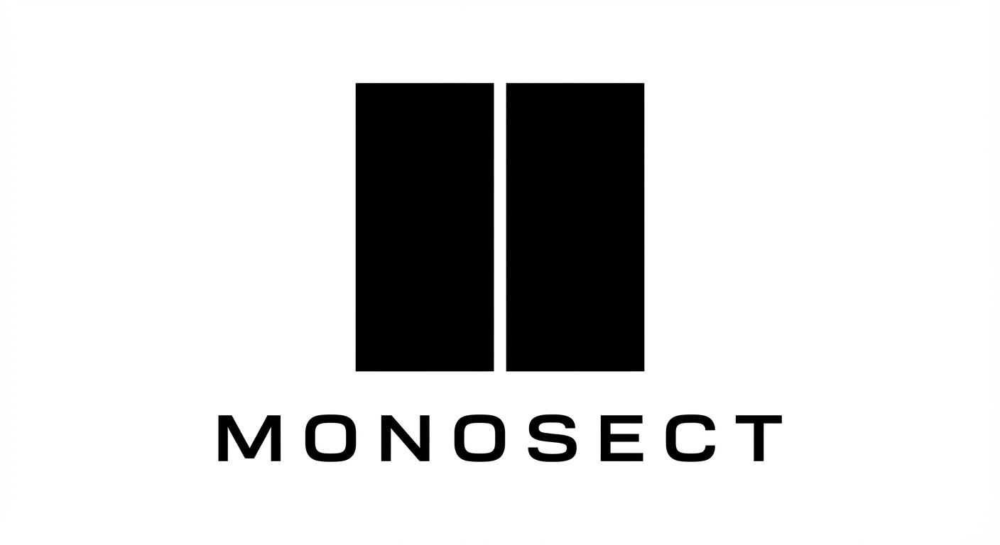

<p align="center">
  
</p>

# Monosect

<p align="center"><em>Monolithic precision. Deterministic segmentation.</em></p>

Monosect is a fast Windows app to split and merge videos.

It is built with C++23, ImGui, and FFmpeg.

No installer needed. Keep the app and image files in one folder and run `Monosect.exe`.

## What it can do

- Split by time, size, half, or torrent-style presets.
- Keep video quality unchanged in **Strict Lossless** mode (`-c copy`).
- Show per-file progress and overall queue progress live.
- Skip files below your minimum size limit.
- Pause, resume, or cancel current work.
- Run dry-run estimate to preview chunk count before splitting.
- Use watch folder mode to auto-add new files.
- Track CPU/throughput in the app while splitting.

## New in this build

- Auto-tuner mode for smarter speed:
  - Adjusts active worker count while jobs run.
  - Uses CPU load + throughput trend to tune concurrency.
  - Applies thread settings to FFmpeg automatically.
- Better split control and safety:
  - Real cancel path for active FFmpeg process.
  - Worker slot gating so jobs don't overload at once.
  - Stable per-job settings snapshot at start.
- Consistent behavior:
  - Time-based and size-based split paths both use the same tuning inputs.
  - Strict Lossless always forces stream copy.

## Quick start

1. Put these files in one folder:
   - `Monosect.exe`
   - `Monosect-icon-square.png`
   - `Monosect-full-logo.png`
2. Run `Monosect.exe`.
3. On first run, FFmpeg is downloaded automatically.
4. Add videos, choose settings, click **Start Split**.

## Build from source

Requirements:

- Windows 10/11 (64-bit)
- MinGW-w64 (GCC 13+)
- CMake 3.24+
- Ninja

Build:

```powershell
cmake -S . -B build -G Ninja -DCMAKE_BUILD_TYPE=Release
cmake --build build --target Monosect
```

Run:

```powershell
.\build\Monosect.exe
```

## Project layout

```text
src/
  ui/         # App UI, queue, controls, logs, metrics
  engine/     # FFmpeg process, split logic, probe, threading, watch folder
  monitor/    # System metrics
  precision/  # Size precision helpers
resources/    # App icon resources
```

## Notes

- Windows-only app.
- FFmpeg binaries are stored next to the app after first download.
- GPU usage graph is placeholder on some setups.

## Branding

Developed under the **Monosect** brand.

- Square icon: `Monosect-icon-square.png`
- Full logo: `Monosect-full-logo.png`

## License

All rights reserved. Proprietary software by Monosect.

